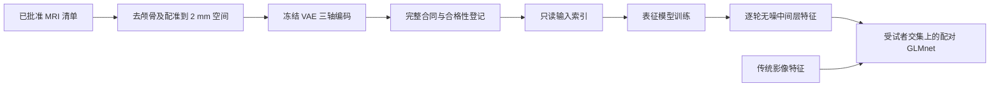

# MRI World

本仓库提供脑 MRI 预处理、冻结 VAE 编码、Wan2.2 表征训练，以及与传统影像特征配对的连续表型预测代码。计算源码与运行数据分开管理；本仓库不包含研究数据、受试者信息、表型、权重或私有服务器配置。

## 安装

模型与 GLMnet 使用两个独立环境，避免 NumPy ABI 冲突。

```bash
conda env create -f environments/model.yml
conda activate mri-world-model
python -m pip install --no-deps -e .

conda env create -f environments/glmnet.yml
```

CUDA 驱动须与所安装 PyTorch 匹配。外部预处理运行时、模板和 Wan 权重从各自原始来源获取，使用前核对许可、文件大小和 SHA-256；不要把这些资源添加进 Git。

## 流程与文件



- [数据格式、预处理与编码](docs/data_and_encoding.md)：2 mm 影像、mask/FOV、三轴 latent 和元数据的关系。
- [训练与检查点](docs/training.md)：训练参数、完整恢复与 GPU 数变化的限制。
- [六卡到八卡完整状态迁移](docs/state_migration.md)：优化器、scheduler、RNG 和原逻辑更新窗口；明确区分已完成收集与待运行阶段。
- [无噪特征](docs/clean_features.md)：直接输入原始 latent，默认不添加扩散噪声。
- [配对连续预测](docs/paired_glmnet.md)：相同受试者、相同外层划分和内部调参，比较表征与传统影像特征。

CLI `--help` 需要模型环境中的依赖。核心模块导入不会自行下载权重或启动 GPU 任务；运行命令必须显式提供数据及资源路径。

## 验证范围

公开测试验证接口、配对划分和计算约定；它们不替代真实 MRI 的质量审核或端到端基准。本仓库没有发布人群预测成绩或受试者级输出。无噪特征、完整 VAE 批次、逐轮预测和正式训练的完成状态分别由对应运行回执确定。

```bash
PYTHONPATH=src python -m pytest tests
```

模型、预处理和权重继续遵守其原始许可证。仓库中的薄适配器不包含第三方模型实现；没有提供第三方数据或权重的再分发许可。
