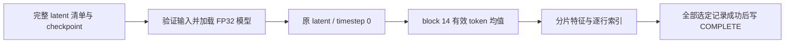

# 无噪声中间层特征

本模块读取用户提供的完整 latent 清单和模型 checkpoint，将原幅度 latent 直接送入 FP32 DiT，在 timestep=0 读取第 14 个零起始 block 的输出，对有效 token 求均值。默认不改变 latent 幅度，且不生成随机噪声。每个 MRI 视角产生一个向量；同 MRI 的三轴合并与同受试者多次扫描合并在下游显式完成。



## 输入、输出与 Python 调用

`manifest` 使用主项目的 latent JSONL/完整 corpus 格式。一行描述一个明确的 MRI 轴或视图，至少包含 `dataset`、`subject_id`、`image_id`、`modality`、`axis`、`split`、`latent_path`、`latent_shape` 及清单协议要求的完整性、质控、空间和 token-mask 信息。`image_id` 必须显式提供，程序不会从文件名推断。每个受试者应只有一种 train/val/test 预训练分组。

`checkpoint` 为本地、由用户持有的 PyTorch state-dict ZIP 文件，或包含 `COMPLETE` 和 `model.pt` 的完整 checkpoint 目录。`model_dir` 为本地 Diffusers Wan2.2 TI2V-5B 根目录。模型、T5 context、MRI、latent 和个体索引由用户自行保管，本仓库不包含这些文件。

```python
from brain_mri_world_model.clean_features import extract_clean

completion = extract_clean(
    manifest="data/latent_manifest.jsonl",       # 用户自己的完整 latent 清单
    model_dir="models/local_wan",               # 本地 Diffusers 模型目录
    checkpoint="checkpoints/epoch/model.pt",    # 已完成的模型 state dict
    output_dir="outputs/clean_features",        # 必须是新目录
    context_path="models/context.pt",          # 或由每条 latent 提供 embedding
    pet_code_root=None,                         # 可选的现有兼容 loader 目录
    splits=("train", "val", "test"),           # 选定的预训练分组
    block_index=14,                             # 零起始编号，第 15 个 block
    shard_size=48,                              # 每片最多保存的轴向量数
    device="cuda:0",                           # 调用者选择的设备
    max_gpu_gib=20.0,                           # CUDA 分配与保留显存上限
)
print(completion["records"], completion["shards"])
```

输出结构：

| 文件 | 内容 |
|---|---|
| `features-000000.pt` 等 | `features`: FP32 `[轴数, 特征维度]`；`records`: 同顺序身份/模态/轴/分组；`provenance`: 同次提取协议 |
| `index.jsonl` | 每个轴的原始显式身份、`feature_path` 和 `feature_row` |
| `provenance.json` | checkpoint/清单摘要、block、均值池化、FP32/TF32、sigma=0、timestep=0、noise_seed=null |
| `COMPLETE` | 只在全部选定记录成功后生成；记录实际轴数、shard 数及本次计时/显存信息 |

部分失败时保留已有目录和文件，不写 `COMPLETE`；新调用必须使用新目录。公开接口没有私有服务器的任务锁或资源调度器，设备调度由调用者负责。

## 参数

| 参数 | 含义 |
|---|---|
| `manifest` | 完整 latent 清单/完整 corpus 的路径 |
| `model_dir` | 本地 Diffusers backbone 根目录 |
| `checkpoint` | 模型 state dict 文件或完整 checkpoint 目录 |
| `output_dir` | 新建输出目录 |
| `context_path` | 公共空文本 embedding 等本地 context；为 `None` 时由 latent 自带 embedding |
| `pet_code_root` | 可选的兼容 loader 路径；为 `None` 时使用 Diffusers 原生 loader |
| `splits` | 读取的预训练 train/val/test 分组；不定义下游表型 CV folds |
| `block_index` | 零起始 block 编号，默认 14；改变它会改变表示协议 |
| `shard_size` | 每片向量数量，默认 48 |
| `device` | 默认 `cuda:0`；`cpu` 可用于软件测试 |
| `max_gpu_gib` | CUDA 显存上限，默认 20 GiB，取值 `(0,20]`；参数保持 FP32 |

还提供两个低层函数：`forward_clean(model, clean, token_mask, embeddings, block_index=14)` 接受一个已冻结、eval 模式 FP32 模型和单条 latent；`mean_valid_tokens(hidden, token_mask)` 接受 FP32 `[B,L,D]` 隐状态及可展平为布尔 `[B,L]` 的 mask，返回 `[B,D]` 均值。空 mask、维度错误或非有限特征均报错。

## 命令行与上游调用

主 Torch 环境中的命令：

```bash
python -m brain_mri_world_model.clean_features \
  --manifest data/latent_manifest.jsonl \
  --model-dir models/local_wan \
  --checkpoint checkpoints/epoch/model.pt \
  --context-path models/context.pt \
  --output-dir outputs/clean_features \
  --splits train val test --block-index 14 --shard-size 48 \
  --device cuda:0 --max-gpu-gib 20
```

对应的上游数值调用是 Diffusers `WanTransformer3DModel` 的原生 forward：

```python
# clean_latent / embeddings / valid_token_mask 由调用者的已验证 loader 提供。
with torch.no_grad(), torch.autocast(clean_latent.device.type, enabled=False):
    transformer(
        hidden_states=clean_latent,
        timestep=torch.full((1,), 0.0, device=clean_latent.device, dtype=torch.float32),
        encoder_hidden_states=embeddings,
        return_dict=False,
    )
# hook 捕获 transformer.blocks[14]；随后对 valid_token_mask 中的 token 求均值。
```

上游视频生成脚本提供视频生成任务。本接口在原生 forward 上读取中间表示。模型和外部权重应从作者发布页按其许可获取，不随代码再分发。

## 验证、精度与耗时记录

本次公共导出保留直接 latent、t=0、FP32/TF32、block 14 和有效 token 均值的数值操作。`tests/test_clean_features.py` 是软件测试，检查 mask 均值、输入直接传入模型、timestep 与 hook 清理；这些小输入不构成 MRI benchmark。

公共仓库未附带可再分发的真实 MRI/模型，也未发布端到端真实数据精度或耗时对比。使用可合法共享的数据进行 benchmark 时，应以相同 checkpoint、相同轴记录和 mask，对比低层原生 forward 与本模块的逐轴向量，报告最大绝对误差、相关系数、加载时间、首轴时间、后续轴时间及峰值分配/保留显存，并另给数据覆盖分母。运行结果中的本次计时字段可作为记录来源；它们不包含已完成的公共 benchmark 结论。

## 更新与参考

- 首次公共版本：导出无噪声、timestep-zero 的单轴表示接口，保留明确的图像身份和新目录输出语义。
- 早期通用噪声特征入口保留其自身协议；此处的固定无噪声方法使用独立模块名。

参考与上游实现：[Wan2.2 官方代码](https://github.com/Wan-Video/Wan2.2)、[Diffusers WanTransformer3DModel 源码](https://github.com/huggingface/diffusers/blob/v0.35.2/src/diffusers/models/transformers/transformer_wan.py)。主环境版本以项目环境文件为准；已核对实现使用 Torch 2.6.0、Diffusers 0.35.2、Transformers 4.56.2。
