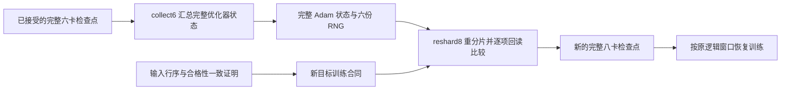

# 六卡到八卡的完整状态迁移

本功能把六个 FSDP rank 的 Adam 状态汇总为按参数名组织的完整状态，再分给八个 rank。模型、Adam step、一阶和二阶矩、参数组、scheduler、原六份 RNG 及训练游标一并保留。整个转换不执行 forward、backward 或 optimizer 更新，模型保持全 float32，启用 TF32。

当前真实验证到**六卡收集完成**：六个进程正常返回，创建者实际 wait 为 0，完整优化器状态已导出，原输入保持不变，新增优化器更新为 0。八卡重分片和八卡训练尚未运行。软件测试通过不代表这两个阶段已经完成。

## 流程与输入输出



输入检查点目录包含：

```text
checkpoint-<九位优化步>/
  COMPLETE
  metadata.json
  model.pt
  rank-00000.pt
  ...
  rank-00005.pt
```

`metadata.json` 必须记录六卡拓扑、完整训练合同及 `epoch`、`next_batch`、`optimizer_step`、`train_examples_seen`。每个 rank 文件必须同时含 `optimizer`、`scheduler`、`rng`。输入必须是已验证、可信的自有检查点；转换使用完整优化器的 Python 状态格式，不接受任意来源的 pickle。

- `collect6` 输出新目录中的 `full_optimizer.pt` 和 `EXPORT_COMPLETE.json`，不复制模型、不更改原检查点。
- `reshard8` 读取上述完整状态，按新八卡拓扑分片，然后重新汇总，逐项比较 tensor、shape、dtype、Adam step 和参数组。全部一致才发布新完整检查点及 `MIGRATION_COMPLETE.json`。
- `attest_index_rows` 比较原/新 SQLite 的完整有序标量记录，不读取 MRI 或 latent。它保留行序、划分、影像与受试者逻辑身份、轴、shape 和 latent 摘要。
- `render_migrated_training` 创建独立训练包，保留当前训练入口；它核对受支持源码摘要及原数学函数，拒绝覆盖已有目标。

固定模型配置为 Wan2.2 TI2V-5B：48 输入/输出通道、30 层、24 个注意力头、每头 128 维、文本维度 4096、patch size `(1,2,2)`。使用与原合同一致的 PyTorch 2.6.0 + CUDA 12.4、Diffusers 0.35.2。依赖从项目模型 Conda 环境安装，不新增外部科学软件依赖。

## Python 调用：保留原优化器窗口

原六卡、每 rank 一条记录、累积四次时，一个完整优化器更新对应 24 条逻辑记录。迁到八卡后，仍使用同一批 24 条记录，分成三个八卡 wave；尾部只补零权重，不扩大有效分母。

```python
from brain_mri_world_model.migration_cursor import window_plan

# 软件接口示例；这些编号不是研究数据或基准。
original_logical_batches = [
    [(logical_batch_index * 6 + rank_index, 1.0) for rank_index in range(6)]
    for logical_batch_index in range(4)
]
optimizer_windows = list(window_plan(
    original_logical_batches,
    source_world_size=6,          # 原物理 rank 数
    target_world_size=8,          # 新物理 rank 数
    micro_batch=1,               # 当前协议仅支持每 rank 一条记录
    gradient_accumulation=4,     # 原优化器窗口含四个逻辑 batch
    next_batch=0,                # 原 global-batch 游标，不能换成新 wave 下标
))
assert optimizer_windows[0]["valid_count"] == 24
assert len(optimizer_windows[0]["physical_batches"]) == 3
```

`window_plan` 返回每个窗口的 `logical_start`、`logical_stop`、`physical_batches`、`valid_count`、`source_entries`、`padding_added`。恢复游标必须在已提交的原优化器窗口边界，或已完成轮次的末尾。`flatten_physical_batches` 只展开物理 batch，不更改窗口边界。

## 显式命令行

所有路径由使用者提供，仓库没有服务器地址或内置项目路径。下面变量应指向自己的已验证文件；摘要应来自已接受回执。输入、临时导出和新输出须位于同一显式项目根目录内，路径不含符号链接。GPU 必须先由使用者获得实际分配；这些命令不代替调度和资源准入。

```bash
# 先设置这些变量；不把真实路径、摘要或资源分配写进公开仓库。
# PROJECT_ROOT：自己的项目根目录
# ORIGINAL_CHECKPOINT：完整六卡检查点
# MODEL_CONFIG_JSON：原模型 transformer/config.json
# NEW_OPTIMIZER_EXPORT：尚不存在的导出目录
# ACCEPTED_METADATA_SHA256：原 metadata.json 的已接受摘要
# ORIGINAL_TRAINING_CODE_SHA256：原训练源码摘要
# ACCEPTED_MODEL_SHA256：原 model.pt 的已接受摘要
# SIX_ASSIGNED_GPUS：已分配的六卡可见设备列表

# 默认只描述，不打开检查点或启动 GPU。
python -m brain_mri_world_model.reshard_optimizer

CUDA_VISIBLE_DEVICES="$SIX_ASSIGNED_GPUS" \
  torchrun --standalone --nproc-per-node=6 \
  -m brain_mri_world_model.reshard_optimizer \
  --phase collect6 --project-root "$PROJECT_ROOT" \
  --checkpoint "$ORIGINAL_CHECKPOINT" --model-config "$MODEL_CONFIG_JSON" \
  --export-dir "$NEW_OPTIMIZER_EXPORT" \
  --expected-metadata-sha256 "$ACCEPTED_METADATA_SHA256" \
  --expected-training-code-sha256 "$ORIGINAL_TRAINING_CODE_SHA256" \
  --source-model-sha256 "$ACCEPTED_MODEL_SHA256" --execute
```

转换 CLI 的其余参数：

| 参数 | 含义 |
| --- | --- |
| `--phase collect6` / `reshard8` | 选择汇总或重分片，不启动训练 |
| `--project-root` | 已存在的本地项目根目录，包含所有输入输出 |
| `--checkpoint` | 原完整六卡检查点目录 |
| `--model-config` | 与原合同 config SHA 一致的模型 JSON |
| `--export-dir` | 汇总阶段的新目录；重分片阶段读取同一导出目录 |
| `--source-model-sha256` | 汇总时记录已接受模型摘要；不重新读取模型计算摘要 |
| `--expected-metadata-sha256` | 精确绑定原训练元数据，拒绝换用其他游标或合同 |
| `--expected-training-code-sha256` | 绑定原训练源码及 FSDP 参数顺序 |
| `--destination-contract` | 八卡重分片所需的新合同，必须绑定原科学设置和输入一致证明 |
| `--output-run-dir` | 八卡重分片的新输出根目录，不得已存在 |
| `--execute` | 显式执行所选阶段；省略时零检查点 I/O、零 GPU 任务 |

先生成输入一致证明，再渲染独立训练包：

```bash
python -m brain_mri_world_model.attest_index_rows \
  --source-index "$ORIGINAL_INDEX_SQLITE" --target-index "$RELOCATED_INDEX_SQLITE" \
  --output "$NEW_INPUT_ATTESTATION"

python -m brain_mri_world_model.render_migrated_training \
  --source-package src/brain_mri_world_model \
  --output-package "$NEW_SOURCE_ROOT/brain_mri_world_model" --execute
```

渲染后的训练入口增加 `--migration-origin-checkpoint`、`--migration-input-attestation` 和 `--migration-contract-output`。前两者绑定原检查点和实际输入一致证明；第三个参数只在单 CPU 进程中生成新合同，不创建 CUDA/NCCL 或训练模型。必须同时传入与原合同相同的训练、模型、文本条件、数据加载和合格性参数；同样本数不代表相同成员。

完成并审查新合同后，才可执行八卡阶段：

```bash
CUDA_VISIBLE_DEVICES="$EIGHT_ASSIGNED_GPUS" \
  torchrun --standalone --nproc-per-node=8 \
  -m brain_mri_world_model.reshard_optimizer \
  --phase reshard8 --project-root "$PROJECT_ROOT" \
  --checkpoint "$ORIGINAL_CHECKPOINT" --model-config "$MODEL_CONFIG_JSON" \
  --export-dir "$NEW_OPTIMIZER_EXPORT" \
  --expected-metadata-sha256 "$ACCEPTED_METADATA_SHA256" \
  --expected-training-code-sha256 "$ORIGINAL_TRAINING_CODE_SHA256" \
  --destination-contract "$REVIEWED_DESTINATION_CONTRACT" \
  --output-run-dir "$NEW_CONVERTED_RUN" --execute
```

独立训练包必须从新完整检查点 `--resume`；没有完整恢复会被拒绝。该入口继续使用原六卡逻辑 batch 和原学习率、AdamW、scheduler、有效样本分母与检查点游标。六份原 RNG 会保存并用于前六个新 rank，新增两个 rank 使用显式可复现派生规则。样本分配和浮点归约顺序会变化，不承诺逐位相同训练轨迹。

## 验证及更新记录

| 阶段 | 当前证据 | 精度与耗时口径 |
| --- | --- | --- |
| 六卡完整状态收集 | 真实创建者 wait0、六进程退出、完整状态导出、零优化器更新 | 状态收集组件完成；本页不提供额外临床精度或速度结论 |
| 八卡重分片及完整状态回读 | 已有执行代码和严格逐项比较，真实阶段未运行 | 尚无真实通过结果或耗时 |
| 八卡逻辑窗口训练恢复 | 窗口、尾部有效分母、恢复边界及原数学 AST 软件检查通过 | 八卡训练未运行；不宣称数值轨迹逐位相同 |

本次新增通用项目路径接口、完整状态转换、逻辑窗口适配器与中文说明。原训练入口和已部署冻结源码保持原样。公开软件测试使用小型元数据/标量夹具，只验证接口和数学约定，不替代真实 MRI benchmark；本操作不产生脑图。

```bash
PYTHONPATH=src python -m unittest discover -s tests -p 'test_state_migration.py' -v
```

## 原 API、源码和参考文献

PyTorch 没有独立的同名迁移 CLI；本仓库的显式入口调用其原生 FSDP optimizer state-dict API，不包含第三方实现副本。参见 [PyTorch 2.6 FSDP 文档](https://docs.pytorch.org/docs/2.6/fsdp.html)、[PyTorch 2.6 原实现](https://github.com/pytorch/pytorch/blob/v2.6.0/torch/distributed/fsdp/fully_sharded_data_parallel.py) 与 [FSDP 论文](https://arxiv.org/abs/2304.11277)。模型架构参见 [Wan2.2 原仓库](https://github.com/Wan-Video/Wan2.2) 和 [TI2V-5B 配置](https://github.com/Wan-Video/Wan2.2/blob/main/wan/configs/wan_ti2v_5B.py)。权重和数据继续按原始许可独立取得，仓库不再分发这些资源。
